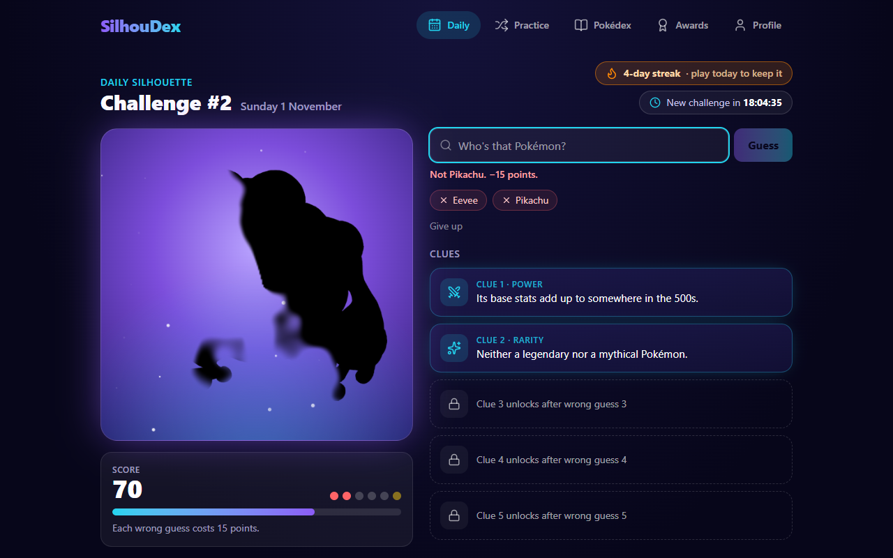

# SilhouDex

> _Every shadow has a story._

[](https://github.com/noeljj77/SilhouDex/actions/workflows/deploy.yml)

SilhouDex is a daily Pokémon mystery guessing game. A partly hidden silhouette melts into view, one wrong guess at a time. Study the shadow, unlock clues, and name the Pokémon before your score runs out. Everyone gets the same mystery Pokémon each UTC day.

**Play it:** https://noeljj77.github.io/SilhouDex/



## Features

- **Daily Silhouette.** One shared Pokémon per UTC day, five reveal stages, five clues and a score that drops 15 points per miss. One final guess after the last reveal. Your result is locked once you finish, so refreshing can't replay it.
- **A reveal that melts in.** A clockwise sweep with fog-soft edges, drawn on a canvas and animated smoothly between stages. No grid, no tiles, no blur: the real artwork is turned into a black silhouette that keeps its transparency.
- **Clues from real data.** 22 kinds of clue (typing, generation, abilities, evolution, size, stats, Pokédex entries and more), chosen per challenge, never repeating, never containing the Pokémon's name. Easy, Normal and Hard clue strengths.
- **Practice.** Unlimited random Pokémon on the same engine. It never touches your daily streak or statistics, and never picks today's daily answer.
- **Daily streaks.** Current and longest streak, a monthly calendar of won, lost, gave-up and missed days, and win-rate and guess-distribution statistics.
- **Discovery Pokédex.** All 1,025 Pokémon. The ones you identify appear in full colour with their discovery dates; the rest stay as silhouettes. Filter by generation, type or status, search and sort.
- **15 achievements.** Locked, in-progress and unlocked states with progress bars, unlock dates and a pop-up when you earn one.
- **Shareable results.** Copy a spoiler-free result, save a PNG result card, or use your phone's share sheet. A switch adds the Pokémon for spoiler versions.
- **Made to be used.** Works on phones and desktops, supports reduced motion and keyboard use, and has offline and error screens.

|                                                      |                                                    |
| ---------------------------------------------------- | -------------------------------------------------- |
|    |            |
|  |  |

<p align="center"></p>

## How it works

- **Same answer for everyone, no server.** The daily Pokémon comes from a fixed, shuffled list of all 1,025 species and the UTC date. A test pins that list, so the answer for every future day can never change by accident.
- **Reveal engine** (`src/domain/reveal`). Each pixel of the silhouette gets a position along a clockwise sweep, pushed about by seeded fog. Showing "12%" or "48%" of the shape is an exact lookup in the sorted positions, and the soft edge is measured in the same units, so it is equally smooth on a round Pokémon and a long, thin one.
- **Clue engine** (`src/domain/clues`). Data-driven providers build clues only from real PokéAPI data, skip anything missing (no habitat for newer Pokémon, no evolution chain), and every clue is checked so it can't contain the Pokémon's name.
- **One save path.** A finished game is recorded once by a single function that stores the result, adds a discovery for wins, and unlocks achievements. Statistics and streaks are always calculated from saved results rather than stored, so they can't drift.
- **Safe storage.** Progress lives in LocalStorage under a versioned schema with migrations, and corrupt or newer-version data is backed up rather than overwritten.
- **Layers kept apart.** UI, hooks, pure game logic, and data access are separate, so a backend can replace the storage later without touching the rules.

## Tech stack

React 19 · TypeScript · Vite · Tailwind CSS 4 · Motion · Lucide · Recharts · Vitest · React Testing Library · [PokéAPI](https://pokeapi.co/)

## Getting started

Requires **Node.js 22.13+**.

```bash
npm install
npm run dev
```

| Script                | What it does                                                                              |
| --------------------- | ----------------------------------------------------------------------------------------- |
| `npm run dev`         | Start the local dev server                                                                |
| `npm run build`       | Type-check and build for production                                                       |
| `npm run preview`     | Preview the production build                                                              |
| `npm test`            | Run the test suite once                                                                   |
| `npm run test:watch`  | Run tests in watch mode                                                                   |
| `npm run lint`        | Lint the codebase                                                                         |
| `npm run format`      | Format files with Prettier                                                                |
| `npm run build:index` | Rebuild the bundled Pokédex index from PokéAPI (`-- --verify-artwork` checks every image) |

The developer-only Silhouette Lab is at `#/lab`.

## Project structure

```
scripts/          build-time tools (Pokédex index generation)
src/
  app/            app shell, routing, progress store, error and offline handling
  pages/          Daily, Practice, Pokédex, Achievements, Profile
  features/       UI grouped by feature (game, pokedex, achievements, profile, share)
  domain/         pure game logic, with no React and no browser APIs
  data/           bundled Pokédex index, PokéAPI client and cache
  persistence/    storage schema, migrations, repository
  lib/            small shared utilities (seeded random, UTC dates)
  test/           test setup and real-data fixtures
docs/screenshots  images used in this README
```

## Quality

- **Over 600 automated tests** cover the game rules, scoring, clue generation, daily schedule, streak edge cases, persistence and migrations, every achievement, the share output, and full Daily and Practice games.
- **Accessibility:** checked with axe on every screen, text contrast checked against the real colours behind it, keyboard-operable guess box and dialogs, screen-reader labels, and reduced-motion support.
- **Security:** the published site ships a strict Content-Security-Policy that only allows the app's own files, PokéAPI, and the image host. Saved data is validated when loaded.
- **Performance:** each page loads on demand, and React, Motion, icons and the Pokémon list are separate cached files.

## Deploying

The site is published to GitHub Pages by `.github/workflows/deploy.yml`. Every push to `main` runs the formatting check, lint, tests and build, and only publishes if all of them pass. The workflow has read-only access to the repository and never pushes commits.

One-time setup: in the repository, go to **Settings → Pages** and set **Source** to **GitHub Actions**.

**Launch date.** The first Daily challenge is the day set in `LAUNCH_DATE` in `src/domain/daily/schedule.ts`. Set it before launch and never change it afterwards: it numbers every challenge and anchors every player's streak calendar.

## Known limits (V1)

- **Frontend only.** There is no server, so a determined player could find the answer by inspecting the app's data. Global leaderboards, accounts and sign-in are planned for V2.
- **Progress is per browser.** It lives in that browser's storage, so it doesn't follow you between devices.
- **Forms.** Regional and alternate forms count as their base Pokémon.

## Disclaimer

SilhouDex is an unofficial, non-commercial fan project. It is not affiliated with, endorsed by, or sponsored by Nintendo, Game Freak, Creatures Inc. or The Pokémon Company. Pokémon and Pokémon character names are trademarks of their respective owners. Pokémon data and artwork come from [PokéAPI](https://pokeapi.co/).
