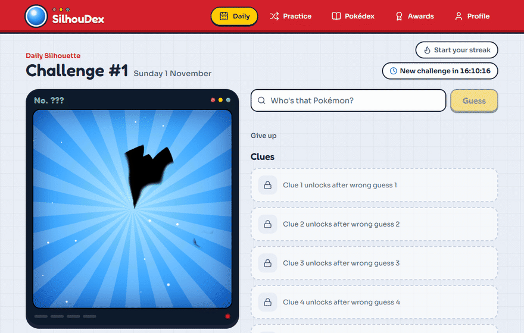
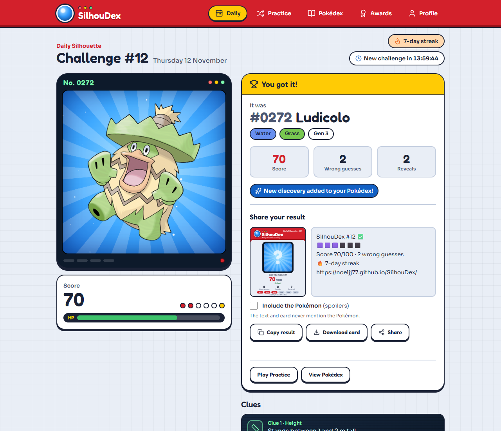
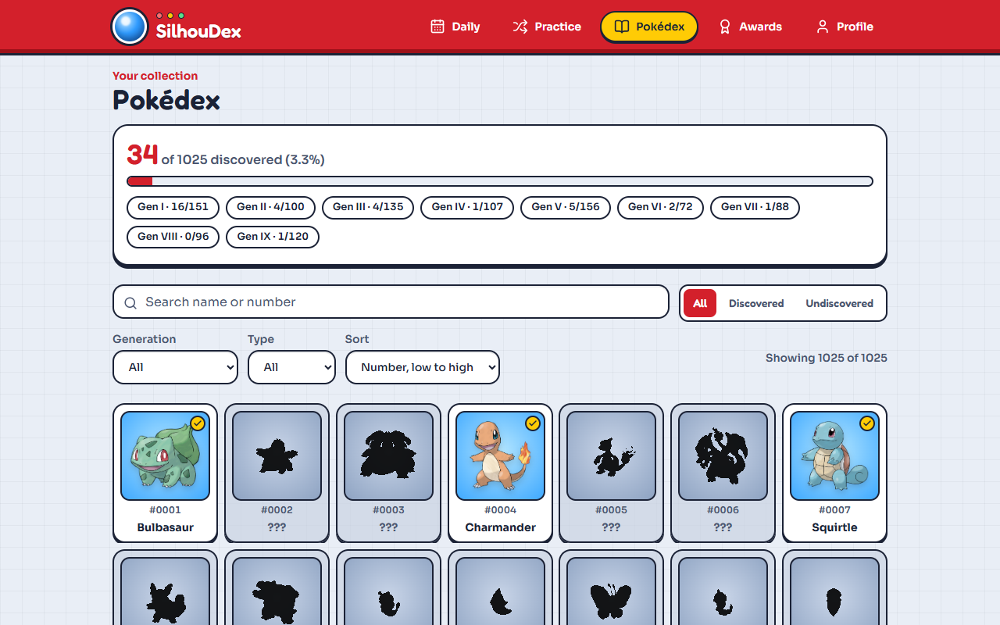
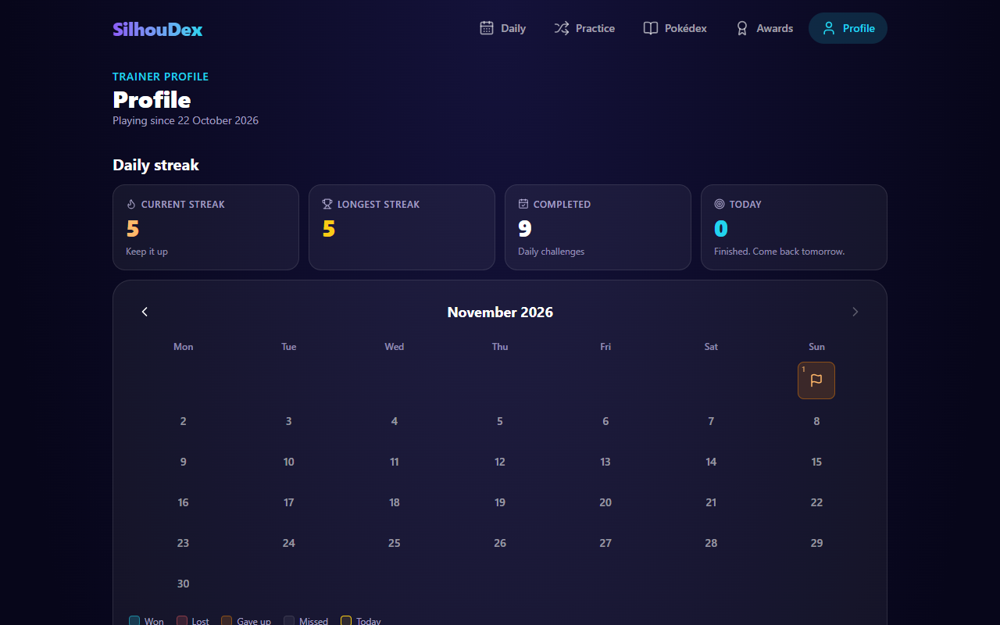
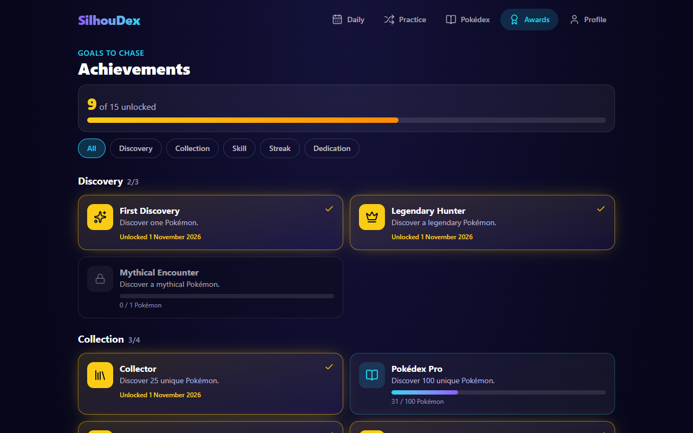
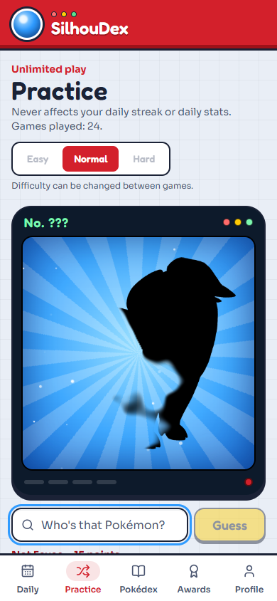

# SilhouDex

> _Who's that Pokémon._

[](https://github.com/noeljj77/SilhouDex/actions/workflows/deploy.yml)
[](https://noeljj77.github.io/SilhouDex/)
[](LICENSE)

SilhouDex is a daily Pokémon mystery guessing game. A partly hidden silhouette melts into view, one wrong guess at a time. Study the shadow, unlock clues, and name the Pokémon before your score runs out. Everyone gets the same mystery Pokémon each UTC day.

**Play it:** https://noeljj77.github.io/SilhouDex/

<p align="center"></p>

## Features

- **Daily Silhouette.** One shared Pokémon per UTC day, five reveal stages, five clues and a score that drops 15 points per miss. One final guess after the last reveal. Your result is locked once you finish, so refreshing can't replay it.
- **A reveal that melts in.** A clockwise sweep with fog-soft edges, drawn on a canvas and animated smoothly between stages. No grid, no tiles, no blur: the real artwork is turned into a black silhouette that keeps its transparency.
- **Clues from real data.** 22 kinds of clue (typing, generation, abilities, evolution, size, stats, Pokédex entries and more), chosen per challenge, never repeating, never containing the Pokémon's name. Easy, Normal and Hard clue strengths.
- **Practice.** Unlimited random Pokémon on the same engine, optionally limited to the generations you choose (for example only Gen I to III). It never touches your daily streak or statistics, and never picks today's daily answer.
- **Daily streaks.** Current and longest streak, a monthly calendar of won, lost, gave-up and missed days, and win-rate and guess-distribution statistics.
- **Discovery Pokédex.** All 1,025 Pokémon. The ones you identify appear in full colour with their discovery dates; the rest stay as silhouettes. Filter by generation, type or status, search and sort.
- **15 achievements.** Locked, in-progress and unlocked states with progress bars, unlock dates and a pop-up when you earn one.
- **Shareable results.** Copy a spoiler-free result, save a PNG result card, or use your phone's share sheet. A switch adds the Pokémon for spoiler versions.
- **Sign in with Google (optional).** Progress is saved to your account and follows you between devices. Playing signed out works exactly the same, on the device only.
- **Made to be used.** A first-visit How to play card, phone and desktop layouts, reduced-motion and keyboard support, and offline and error screens.

|                                                      |                                                    |
| ---------------------------------------------------- | -------------------------------------------------- |
|    |            |
|  |  |

<p align="center"></p>

## Engineering highlights

- **Same answer for everyone, no game server.** The daily Pokémon comes from a fixed, shuffled list of all 1,025 species and the UTC date. A test pins that list, so the answer for every future day can never change by accident.
- **Reveal engine** (`src/domain/reveal`). Each pixel of the silhouette gets a position along a clockwise sweep, pushed about by seeded fog. Showing "12%" or "48%" of the shape is an exact lookup in the sorted positions, and the soft edge is measured in the same units, so it is equally smooth on a round Pokémon and a long, thin one.
- **Clue engine** (`src/domain/clues`). Data-driven providers build clues only from real PokéAPI data, skip anything missing (no habitat for newer Pokémon, no evolution chain), and every clue is checked so it can't contain the Pokémon's name.
- **One save path.** A finished game is recorded once by a single function that stores the result, adds a discovery for wins, and unlocks achievements. Statistics and streaks are always calculated from saved results rather than stored, so they can't drift.
- **Safe storage.** Progress lives in LocalStorage under a versioned schema with migrations. Corrupt or newer-version data is backed up rather than overwritten, and everything loaded is validated.
- **Cloud saving that can't lose progress** (`src/cloud`, `src/domain/progression/merge.ts`). Signing in merges the saved copy with the device's progress (the earliest finished result wins a day, discoveries and achievements keep their earliest dates), and nothing is saved until that merge has happened, so a failed load can never overwrite a good save. Progress from one account is never carried into another on a shared device. The sync logic talks to a small `CloudBackend` interface, so it is tested with a fake instead of Firebase.
- **Security.** A strict Content-Security-Policy lists the exact hosts the app talks to (its own files, PokéAPI, and the specific Google endpoints sign-in needs). Firestore rules let each player read and write only their own document, with a fixed shape and size limit ([`firestore.rules`](firestore.rules)).
- **Layers kept apart.** UI, hooks, pure game logic, data access and cloud code are separate. `src/domain` has no React and no browser APIs.

## Tech stack

React 19 · TypeScript · Vite · Tailwind CSS 4 · Motion · Lucide · Recharts · Firebase (Auth and Firestore) · Vitest · React Testing Library · GitHub Actions and Pages · [PokéAPI](https://pokeapi.co/)

## Getting started

Requires **Node.js 22.13+**.

```bash
npm install
npm run dev
```

| Script                | What it does                                                                              |
| --------------------- | ----------------------------------------------------------------------------------------- |
| `npm run dev`         | Start the local dev server                                                                |
| `npm run build`       | Type-check and build for production                                                       |
| `npm run preview`     | Preview the production build                                                              |
| `npm test`            | Run the test suite once                                                                   |
| `npm run test:watch`  | Run tests in watch mode                                                                   |
| `npm run test:e2e`    | Build the site and run the browser tests (first run `npx playwright install chromium`)    |
| `npm run lint`        | Lint the codebase                                                                         |
| `npm run format`      | Format files with Prettier                                                                |
| `npm run build:index` | Rebuild the bundled Pokédex index from PokéAPI (`-- --verify-artwork` checks every image) |

The developer-only Silhouette Lab (`#/lab`) is available in `npm run dev` and is left out of the published site, because it shows answers.

## Project structure

```
scripts/          build-time tools (Pokédex index generation)
e2e/              browser tests (Playwright) run against the production build
src/
  app/            app shell, routing, progress store, error and offline handling
  pages/          Daily, Practice, Pokédex, Achievements, Profile
  features/       UI grouped by feature (game, pokedex, achievements, profile, share, account, help)
  components/     small shared pieces (Poké Ball icon, type colours, dialog keyboard handling)
  domain/         pure game logic, with no React and no browser APIs
  cloud/          Google sign-in, Firestore saving and the sync controller
  data/           bundled Pokédex index, PokéAPI client and cache
  persistence/    storage schema, migrations, repository
  lib/            small shared utilities (seeded random, UTC dates)
  test/           test setup and real-data fixtures
docs/             setup guide for Google sign-in, README images and the demo GIF
```

## Quality

- **660+ unit and component tests** cover the game rules, scoring, clue generation, daily schedule, streak edge cases, persistence and migrations, every achievement, the share output, cloud merging and syncing (including failure cases), and full Daily and Practice games.
- **Browser tests** (`e2e/`, Playwright) drive the production build in a real browser: a whole Daily game with a refresh in the middle, the locked day, sharing, Practice staying separate, the UTC-midnight rollover, a corrupt save and going offline. They also check that nothing scrolls sideways at ten widths from 320 to 1920 pixels, that the console is clean and the Content-Security-Policy is strict, and that axe finds no violations (WCAG 2.2 AA) on every screen, dialog and game state, on a phone and a desktop.
- **Accessibility:** beyond the automated scan, the guess box and dialogs work by keyboard with screen-reader labels, tiles are named by what they show, and reduced motion stops the decorative animation.
- **Continuous integration:** every push and pull request runs the formatting check, lint, unit tests, build and the browser tests. Only a green run on `main` is published, and Dependabot keeps dependencies current.
- **Performance:** each page loads on demand, and React, Motion, icons and the Pokémon list are separate cached files. The Firebase code is a separate file, kept out of the game's own bundle.

## Deploying

The site is published to GitHub Pages by `.github/workflows/deploy.yml`. Every push to `main` runs the checks above, and only publishes if all of them pass. The workflow has read-only access to the repository and never pushes commits.

One-time setup: in the repository, go to **Settings → Pages** and set **Source** to **GitHub Actions**.

**Launch date.** The first Daily challenge is the day set in `LAUNCH_DATE` in `src/domain/daily/schedule.ts`. It numbers every challenge and anchors every player's streak calendar, so it must never change.

## Running your own copy with Google sign-in

Sign-in is optional and switches on only when the Firebase settings in `src/cloud/firebaseConfig.ts` are filled in. To use your own Firebase project, follow [docs/firebase-setup.md](docs/firebase-setup.md): create the project, enable Google sign-in, publish the Firestore rules and paste in the web app settings (public identifiers, not secrets). Without them the app runs on-device only and shows no sign-in button.

## Known limits

- **No game server.** The answers are in the app's data, so a determined player could find them by inspecting it. Global leaderboards are planned.
- **Forms.** Regional and alternate forms count as their base Pokémon.
- **Per-device progress when signed out.** It lives in that browser's storage until the player signs in.

## Roadmap

- Global leaderboard and extra game modes, which need a small backend.
- Browser tests for Google sign-in against a Firebase emulator (today the sign-in window itself is checked by hand, because it needs a real Google account).

## Licence

The code is released under the [MIT licence](LICENSE). The licence covers the source code only, not Pokémon names or artwork (see the disclaimer below). The Sora and Fredoka fonts are bundled under the SIL Open Font License.

## Disclaimer

SilhouDex is an unofficial, non-commercial fan project. It is not affiliated with, endorsed by, or sponsored by Nintendo, Game Freak, Creatures Inc. or The Pokémon Company. Pokémon and Pokémon character names are trademarks of their respective owners. Pokémon data and artwork come from [PokéAPI](https://pokeapi.co/).
